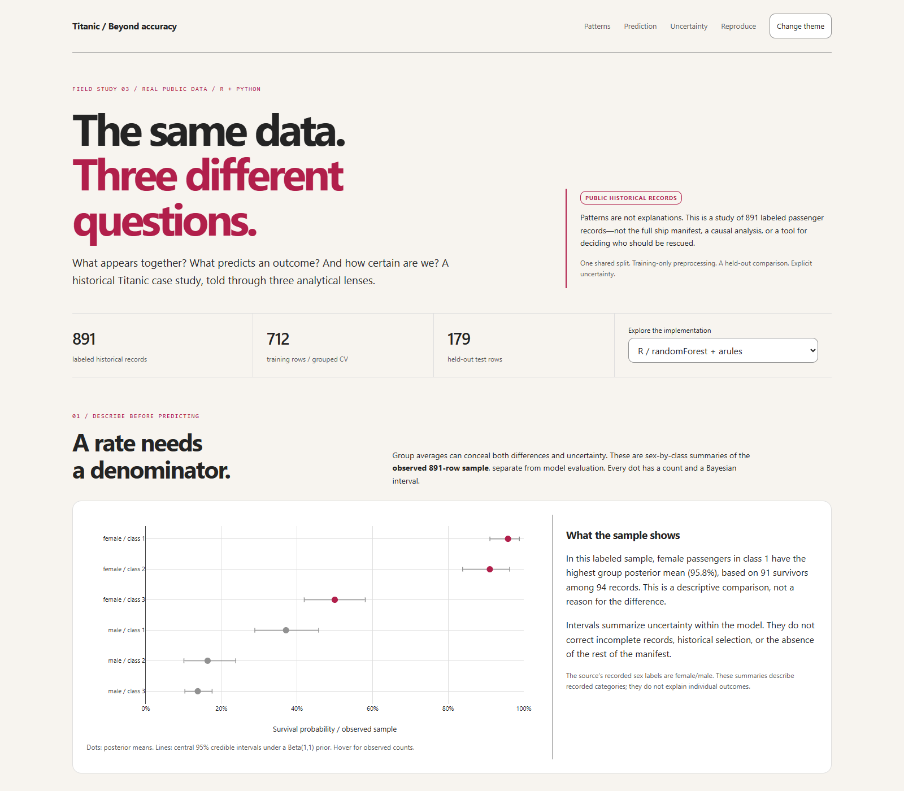

# Titanic / Patterns, Prediction & Uncertainty

### The same data. Three different questions.

**A real, public-data case study in R and Python.** Association rules describe
co-occurrence, random forest predicts an outcome, and Bayesian analysis makes
model-based uncertainty visible. The methods are complementary—not interchangeable.



**[Explore the interactive story](https://mberca.github.io/titanic-patterns/)** ·
**[Start in R](R/README.md)** · **[Python edition](Python/README.md)** ·
**[Methodology](METHODOLOGY.md)**

## Find your way

| Your goal | Start here |
|---|---|
| See the visual story without installing anything | [Interactive demo](https://mberca.github.io/titanic-patterns/) |
| Run or read the R edition | [`R/`](R/) · [`titanic-patterns.Rproj`](titanic-patterns.Rproj) |
| Run or read the Python edition | [`Python/`](Python/) · [Executed notebook](notebooks/01_titanic_python.ipynb) |
| Understand where the real data came from | [Data guide](data/README.md) · [Pinned provenance](data/provenance.json) |
| Inspect the exact train/test/validation assignments | [`data/split.csv`](data/split.csv) |
| Inspect model scores, rules, and uncertainty estimates | [R results](outputs/r/) · [Python results](outputs/python/) |
| Check what is being compared | [Prespecified analysis contract](METHODOLOGY.md) |
| Browse the wider portfolio | [GitHub profile](https://github.com/mberca) |

## The questions

1. **Describe:** How do survival rates vary across sex-by-class strata in the
   observed sample, and how do counts affect their uncertainty?
2. **Discover:** Which attribute combinations co-occur with a survival outcome
   in the training data, relative to the outcome's baseline frequency?
3. **Predict:** How do a prevalence baseline, random forest, and Bayesian
   logistic model compare on the same held-out passengers?
4. **Qualify:** What do probability calibration, coefficient uncertainty,
   missing records, and sample selection stop us from claiming?

## What makes this more than a Titanic accuracy exercise

- **One split, two languages:** 712 training rows and 179 held-out test rows.
  Shared tickets stay together to reduce cross-group leakage. Ticket groups
  are not perfect family identifiers.
- **Training-only preprocessing:** medians, the embarkation mode, centering,
  and scaling are refitted inside each of five grouped validation folds.
- **More than accuracy:** ROC AUC, Brier score, log loss, balanced accuracy,
  ROC curves, and reliability plots with bin counts.
- **Transparent Bayesian methods:** exact Beta(1,1) conjugate group summaries
  and a documented Laplace approximation for logistic coefficients.
- **A fair comparison:** prespecified forest settings and priors, a constant
  baseline, and no tuning against the test set.
- **Honest scope:** 891 labeled historical records, not the complete ship
  manifest and not a representative modern deployment population.

## Run it

Use the [R guide](R/README.md) or [Python guide](Python/README.md) for dependency
installation, analysis commands, notebook execution, and focused tests. Default
analysis runs read the committed public-data extract; no Kaggle account, API
key, or internet connection is needed.

The R and Python programs write separate results into `outputs/r/` and
`outputs/python/`, so rerunning one never silently replaces the other's results.

## A few results to explore

The **R edition's held-out results** illustrate why multiple views matter:

| Model | ROC AUC ↑ | Brier score ↓ | Log loss ↓ |
|---|---:|---:|---:|
| Prevalence baseline | 0.500 | 0.237 | 0.667 |
| Random forest | 0.894 | 0.112 | 0.410 |
| Bayesian logistic | 0.880 | 0.136 | 0.422 |

These are one fixed 179-record holdout, not proof of statistically significant
or universal superiority. The visual story also shows five-fold development
scores and calibration-bin counts. Switch to Python to inspect that edition's
forest rather than assuming the two implementations are identical.

**46 training-only association rules** pass the prespecified exploratory
thresholds. The rules and Bayesian coefficients agree numerically across
languages. For the descriptive Bayesian summaries, the 91 survivors among
94 recorded first-class female passengers become a Beta(92,4) posterior:
an explicit model of an observed subgroup, not a causal explanation.

## Rebuild the browser story

After generating both editions, verify the shared evidence and rebuild the
self-contained browser story from the repository root:

```powershell
python scripts/check_parity.py
python scripts/build_story.py
```

The parity check compares feature matrices, Bayesian coefficients and intervals,
rule counts and metrics, and descriptive beta summaries. It deliberately does
**not** require identical forest predictions: R's `randomForest` and
scikit-learn use different implementations and probability definitions.

The browser story embeds Plotly and all required result data. Open
`docs/index.html` directly; the public demo publishes `main:/docs` with GitHub Pages. There
is no backend, account requirement, analytics, external font, or CDN dependency.

## Bayesian does not mean exact

The logistic model uses Normal(0, 2.5²) priors for coefficients and Normal(0, 5²)
for the intercept. A posterior mode and inverse Hessian provide a **Laplace
approximation**. Reported coefficient intervals are approximate, marginal 95%
credible intervals. Evaluation uses **posterior-mode plug-in probabilities**,
not a fully integrated posterior predictive. This is not MCMC, and no
convergence-diagnostic claim is made.

Separately, the descriptive sex-by-class rates use an exact Beta(1,1) update.
Those summaries use the observed labeled sample and are clearly separated
from training and held-out model evaluation.

## Data, interpretation, and responsible use

The source is Paul Hendricks' **titanic** package, whose pinned metadata declares
CC0. It distributes the labeled Titanic competition training sample.
The [data guide](data/README.md) records the immutable source URL and checksum.
Names, cabin strings, and ticket strings are not retained in the committed extract.

Association rules and coefficients do not establish why someone survived.
Sex, class, family composition, and fare are correlated with unobserved historical
circumstances. This project is **not** a causal study, a rescue-prioritization
system, or evidence supporting discriminatory decisions. A small holdout does
not establish universal model superiority or statistically significant differences.

Missing data, curated records, imperfect group identifiers, model assumptions,
and a deliberately limited feature set constrain the conclusions. Read the
[full methodology](METHODOLOGY.md) before reusing the analysis.

## Repository map

```text
R/                       R-first analysis, tests, and executable narrative
Python/                  Python analysis and run instructions
notebooks/               Executed Python notebook
data/                    Minimal public-data extract, split, provenance
outputs/r/               R model scores, predictions, rules, intervals, figures
outputs/python/          Python model scores, predictions, rules, intervals, figures
scripts/prepare_data.py  Recreate and checksum-check the public-data extract
scripts/check_parity.py  Compare shared evidence across implementations
scripts/build_story.py   Bundle result tables into the offline visual story
web/story.html           Authored story layout and interaction code
docs/index.html          Generated standalone demo / GitHub Pages entry
METHODOLOGY.md           Evaluation, features, priors, thresholds, and limits
```

## License

Application code and original documentation: [MIT](LICENSE). The public-data
source declares **CC0**; see [provenance](data/provenance.json). The generated
demo embeds Plotly.js and retains its upstream license notice. Dependencies
retain their respective licenses.
