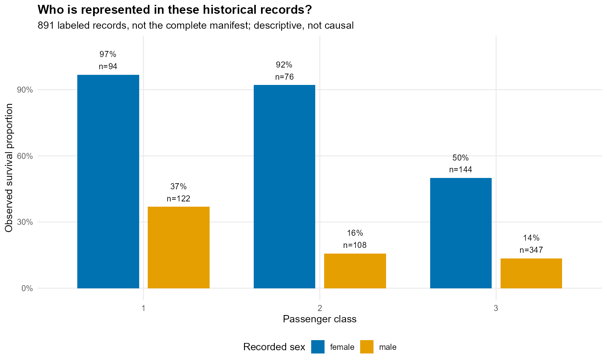
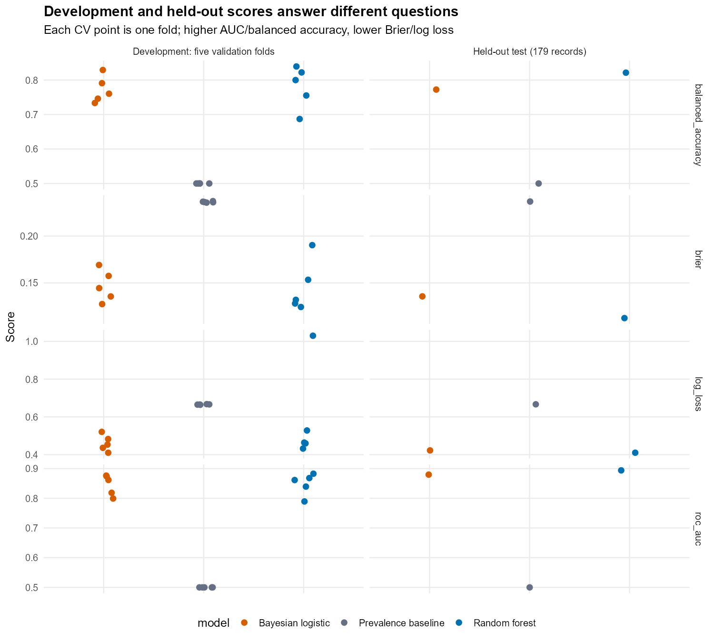
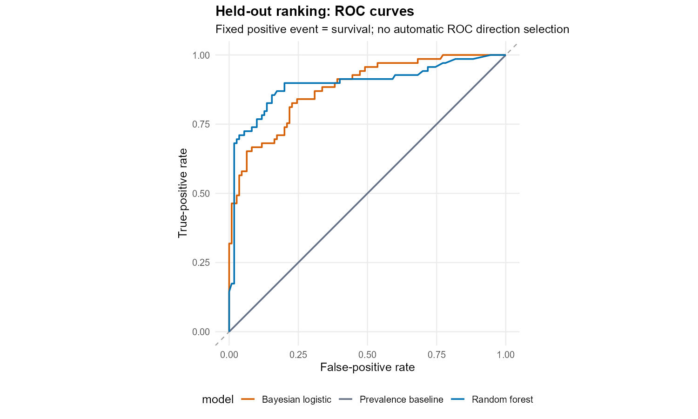
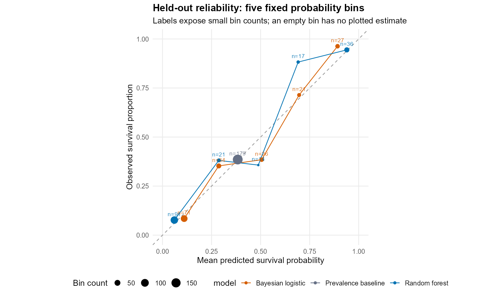
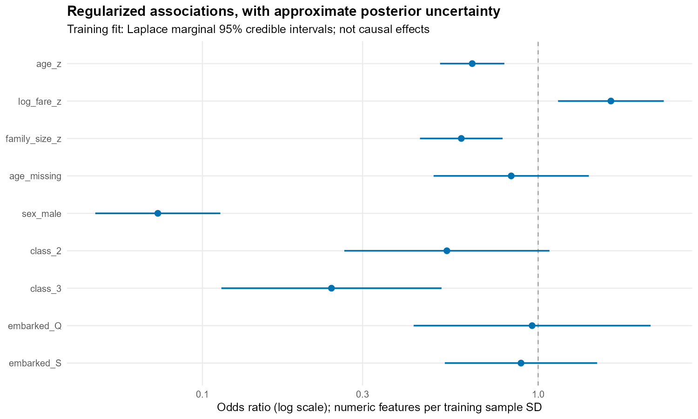
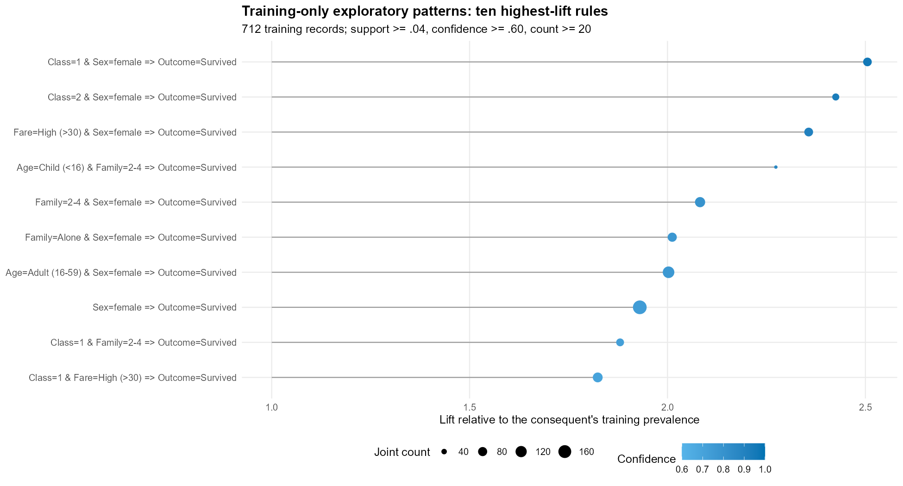
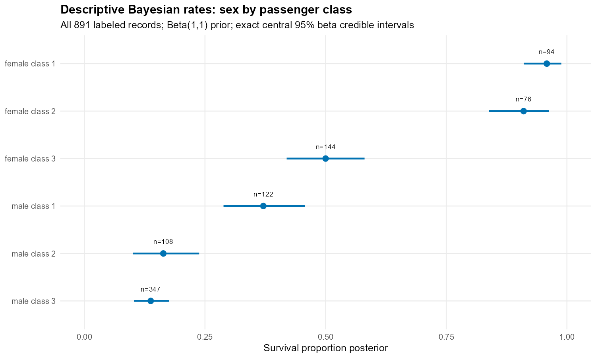

``` r
source("R/analysis.R")
inputs <- load_inputs(".")
d <- inputs$data
s <- inputs$split
out <- file.path("outputs", "r")
if (!file.exists(file.path(out, "metrics.csv"))) {
  run_analysis(".")
}
metrics <- read.csv(file.path(out, "metrics.csv"))
rates <- read.csv(file.path(out, "bayesian_rates.csv"))
rules <- read.csv(file.path(out, "rules.csv"))
coefficients <- read.csv(file.path(out, "coefficients.csv"))
```

## 1. A selected historical sample, not a complete manifest

The analysis uses **891 labeled passenger records** from the pinned,
CC0-declared public source described in the root documentation. They are not
the entire Titanic manifest or a random sample of a modern population.
Names, ticket strings, and cabins are not predictors or rule items. Group
identifiers preserve shared tickets across the committed split but do not
perfectly identify families or social groups.


``` r
knitr::kable(data.frame(
  subset = c("Training", "Held-out test"),
  n = c(sum(s$subset == "train"), sum(s$subset == "test")),
  survived = c(sum(d$Survived[s$subset == "train"]),
               sum(d$Survived[s$subset == "test"]))),
  caption = "The split is committed once and shared by both languages.")
```


Table: The split is committed once and shared by both languages.

|subset        |   n| survived|
|:-------------|---:|--------:|
|Training      | 712|      273|
|Held-out test | 179|       69|

``` r
knitr::kable(read.csv(file.path(out, "missingness.csv")), digits = 3,
             caption = "Missing fractions refer to all 891 labeled records.")
```


Table: Missing fractions refer to all 891 labeled records.

|field       | n_missing| pct_missing|
|:-----------|---------:|-----------:|
|PassengerId |         0|       0.000|
|Survived    |         0|       0.000|
|Pclass      |         0|       0.000|
|Sex         |         0|       0.000|
|Age         |       177|       0.199|
|SibSp       |         0|       0.000|
|Parch       |         0|       0.000|
|Fare        |         0|       0.000|
|Embarked    |         2|       0.002|



Recorded sex and passenger class have visibly different observed survival
proportions in this selected sample. These are descriptions of historical
records, not explanations of why a person survived, causal effects, or a
basis for discriminatory decisions.

## 2. Predictive comparison: fit locally, assess on unseen groups

The three prespecified models are a training-prevalence baseline, a
500-tree random forest (`mtry=3`, `nodesize=5`), and regularized Bayesian
logistic regression. The seed is `20261014`. Each of five training validation
folds refits its own medians, embarkation mode, and sample-standard-deviation
scales. The final models fit on all 712 training rows and transform the same
179 test rows without refitting preprocessing.

The ordered inputs are age_z, log_fare_z, family_size_z, age_missing, sex_male, class_2, class_3, embarked_Q, embarked_S. Age and fare
use training medians; missing embarkation uses the alphabetical-first training
mode in a tie. Fare is transformed with `log1p`; family size is
`SibSp + Parch + 1`. Numeric covariates are centered and scaled with training
sample SD; zero SD is replaced by one.


``` r
cv <- metrics[metrics$phase == "cv", ]
cv_summary <- aggregate(cbind(roc_auc, brier, log_loss, balanced_accuracy) ~ model,
                        cv, mean)
knitr::kable(cv_summary, digits = 4,
             caption = "Unweighted mean of the five validation-fold scores (development only).")
```


Table: Unweighted mean of the five validation-fold scores (development only).

|model               | roc_auc|  brier| log_loss| balanced_accuracy|
|:-------------------|-------:|------:|--------:|-----------------:|
|Bayesian logistic   |  0.8459| 0.1468|   0.4605|            0.7720|
|Prevalence baseline |  0.5000| 0.2364|   0.6657|            0.5000|
|Random forest       |  0.8482| 0.1456|   0.5827|            0.7808|

These means describe the particular committed folds, not five independent
experiments or a confidence interval. No hyperparameters are selected from
the held-out scores.


``` r
test_scores <- metrics[metrics$phase == "test", ]
knitr::kable(test_scores[c("model", "roc_auc", "brier", "log_loss",
                           "balanced_accuracy", "n")], digits = 4,
             caption = "Held-out performance, reported once without test-driven tuning.")
```


Table: Held-out performance, reported once without test-driven tuning.

|   |model               | roc_auc|  brier| log_loss| balanced_accuracy|   n|
|:--|:-------------------|-------:|------:|--------:|-----------------:|---:|
|16 |Prevalence baseline |  0.5000| 0.2369|   0.6667|            0.5000| 179|
|17 |Random forest       |  0.8939| 0.1124|   0.4101|            0.8214| 179|
|18 |Bayesian logistic   |  0.8796| 0.1356|   0.4224|            0.7724| 179|

In this particular holdout, the forest's Brier score is
**0.112**,
compared with **0.237**
for the constant baseline and
**0.136**
for the Bayesian plug-in model. Thus, the modeled historical characteristics
carry predictive information in this partition; that finding does not explain
survival mechanisms or certify performance on another population.

Higher ROC AUC and balanced accuracy are better; lower Brier score and log
loss are better. Balanced accuracy uses a fixed probability threshold of
**at least 0.5**. ROC calculations always use survival as the positive event
and a fixed direction; no automatic direction selection is permitted.







The test set contains only 179 records. Scores and small-bin reliability
estimates can move with another sample or grouped partition. These figures
do not establish a statistically significant gain or a universally best
algorithm. R and Python forests need not agree: their fitting algorithms
and probability definitions differ even with matched settings.

## 3. Bayesian logistic regression: approximate uncertainty, explicit prediction

The intercept has a zero-centered Normal prior with SD 5; all other
coefficients have independent zero-centered Normal priors with SD 2.5.
Analytic-gradient BFGS, followed by analytic Newton polishing, finds the
posterior mode with explicit convergence and gradient checks.
The inverse analytic negative-log-posterior Hessian
provides a **Laplace approximation** to the coefficient covariance.


``` r
knitr::kable(coefficients, digits = 4,
             caption = "Posterior modes and approximate marginal 95% credible intervals.")
```


Table: Posterior modes and approximate marginal 95% credible intervals.

|term          | estimate|     sd|   lower|   upper| odds_ratio| or_lower| or_upper| prior_sd|
|:-------------|--------:|------:|-------:|-------:|----------:|--------:|--------:|--------:|
|intercept     |   2.1074| 0.3912|  1.3406|  2.8742|     8.2267|   3.8212|  17.7112|      5.0|
|age_z         |  -0.4522| 0.1124| -0.6725| -0.2318|     0.6363|   0.5104|   0.7931|      2.5|
|log_fare_z    |   0.4992| 0.1850|  0.1365|  0.8619|     1.6474|   1.1463|   2.3675|      2.5|
|family_size_z |  -0.5270| 0.1446| -0.8104| -0.2436|     0.5904|   0.4447|   0.7838|      2.5|
|age_missing   |  -0.1846| 0.2717| -0.7171|  0.3478|     0.8314|   0.4882|   1.4160|      2.5|
|sex_male      |  -2.6085| 0.2189| -3.0375| -2.1795|     0.0736|   0.0480|   0.1131|      2.5|
|class_2       |  -0.6258| 0.3590| -1.3294|  0.0778|     0.5348|   0.2646|   1.0809|      2.5|
|class_3       |  -1.4176| 0.3853| -2.1727| -0.6624|     0.2423|   0.1139|   0.5156|      2.5|
|embarked_Q    |  -0.0412| 0.4146| -0.8539|  0.7714|     0.9596|   0.4258|   2.1628|      2.5|
|embarked_S    |  -0.1175| 0.2666| -0.6399|  0.4049|     0.8891|   0.5273|   1.4992|      2.5|



The odds ratios are conditional model associations. Numeric coefficients
represent one training sample SD; binary coefficients use female, first
class, and embarkation at C as references. The missing-age flag is included.
Marginal intervals do not capture every model, selection, or historical
measurement uncertainty. These are not frequentist confidence intervals.

All reported Bayesian predictive scores use **posterior-mode plug-in
probabilities**. They are not integrated posterior predictive probabilities.
This is neither MCMC nor an exact posterior analysis.

## 4. Exploratory association rules: count first, then interpret

Only the 712 training records are transactions. Survival is confined to
one consequent item, never an antecedent. Antecedents use at most two items
from recorded sex, class, raw age category, family category, or raw fare
category. Missing ages/fares become `Unknown`, not imputed values. The
fixed filters are support at least 0.04, confidence at least 0.60,
joint count at least 20, lift at least 1.0, and total rule length 2–3.


``` r
knitr::kable(head(rules, 10), digits = 3,
             caption = paste(nrow(rules), "retained exploratory rules; complete export in rules.csv."))
```


Table: 46 retained exploratory rules; complete export in rules.csv.

|antecedent                     |consequent       | support| confidence|  lift| count| antecedent_count| consequent_count| baseline|   N|
|:------------------------------|:----------------|-------:|----------:|-----:|-----:|----------------:|----------------:|--------:|---:|
|Class=1 & Sex=female           |Outcome=Survived |   0.103|      0.961| 2.505|    73|               76|              273|    0.383| 712|
|Class=2 & Sex=female           |Outcome=Survived |   0.074|      0.930| 2.425|    53|               57|              273|    0.383| 712|
|Fare=High (>30) & Sex=female   |Outcome=Survived |   0.105|      0.904| 2.357|    75|               83|              273|    0.383| 712|
|Age=Child (<16) & Family=2-4   |Outcome=Survived |   0.048|      0.872| 2.274|    34|               39|              273|    0.383| 712|
|Family=2-4 & Sex=female        |Outcome=Survived |   0.139|      0.798| 2.082|    99|              124|              273|    0.383| 712|
|Family=Alone & Sex=female      |Outcome=Survived |   0.114|      0.771| 2.012|    81|              105|              273|    0.383| 712|
|Age=Adult (16-59) & Sex=female |Outcome=Survived |   0.181|      0.768| 2.003|   129|              168|              273|    0.383| 712|
|Sex=female                     |Outcome=Survived |   0.260|      0.740| 1.930|   185|              250|              273|    0.383| 712|
|Class=1 & Family=2-4           |Outcome=Survived |   0.087|      0.721| 1.880|    62|               86|              273|    0.383| 712|
|Class=1 & Fare=High (>30)      |Outcome=Survived |   0.131|      0.699| 1.824|    93|              133|              273|    0.383| 712|

The leading retained pattern is **Class=1 & Sex=female**
with consequent **Outcome=Survived**. It covers
**73 joint records** among **76**
matching antecedents, rather than a large lift derived from a hidden tiny
denominator. Its confidence is **96.1%**,
compared with a consequent baseline of
**38.3%** in training.



Support is joint count divided by the true training N. Confidence is joint
count divided by antecedent count; lift divides confidence by that rule's
consequent prevalence. Rules for non-survival therefore have a different
baseline from survival rules. Repeated and overlapping patterns are expected.
The thresholds are discovery filters, not significance tests. These
training-only exhibits are not validated predictions or causal discoveries.

## 5. A separate Bayesian question: describe sex-by-class rates

For this section **all 891 labeled records** describe six historical strata.
A Beta(1,1) prior and `s` survivors among `n` records yield
Beta(`s+1`, `n-s+1`). The table reports the exact conjugate posterior mean
and central 95% beta credible interval. This separate descriptive
calculation does not enter model fitting, preprocessing, rule mining,
or held-out performance.


``` r
knitr::kable(rates, digits = 4,
             caption = "Full-sample descriptive posterior; group counts remain visible.")
```


Table: Full-sample descriptive posterior; group counts remain visible.

|sex    | pclass|   n| survived| observed_rate| posterior_mean|  lower|  upper| prior_alpha| prior_beta|
|:------|------:|---:|--------:|-------------:|--------------:|------:|------:|-----------:|----------:|
|female |      1|  94|       91|        0.9681|         0.9583| 0.9105| 0.9884|           1|          1|
|male   |      1| 122|       45|        0.3689|         0.3710| 0.2884| 0.4575|           1|          1|
|female |      2|  76|       70|        0.9211|         0.9103| 0.8381| 0.9627|           1|          1|
|male   |      2| 108|       17|        0.1574|         0.1636| 0.1009| 0.2379|           1|          1|
|female |      3| 144|       72|        0.5000|         0.5000| 0.4193| 0.5807|           1|          1|
|male   |      3| 347|       47|        0.1354|         0.1375| 0.1035| 0.1755|           1|          1|



Large differences in these observed records do not identify mechanisms.
The posterior intervals are conditional on the binomial model and prior,
not a correction for missing records, selection, dependence, or confounding.

## Reproduce and inspect

From the repository root, run `source("R/run_analysis.R")`, then
`source("R/test-analysis.R")`. See `R/README.md` for rendering commands.
CSV files retain high precision; `preprocessing.json` records the final
training transform. `session-info.txt` records package versions and the
maximum final MAP gradient. No real-passenger simulator or rescue advice
is included.


``` r
sessionInfo()
```

```
## R version 4.4.3 (2025-02-28 ucrt)
## Platform: x86_64-w64-mingw32/x64
## Running under: Windows 11 x64 (build 26310)
## 
## Matrix products: default
## 
## 
## locale:
## [1] LC_COLLATE=English_Ireland.utf8  LC_CTYPE=English_Ireland.utf8   
## [3] LC_MONETARY=English_Ireland.utf8 LC_NUMERIC=C                    
## [5] LC_TIME=English_Ireland.utf8    
## 
## time zone: Europe/Dublin
## tzcode source: internal
## 
## attached base packages:
## [1] stats     graphics  grDevices utils     datasets  methods   base     
## 
## loaded via a namespace (and not attached):
## [1] compiler_4.4.3 tools_4.4.3    knitr_1.47     xfun_0.44      evaluate_0.23
```
